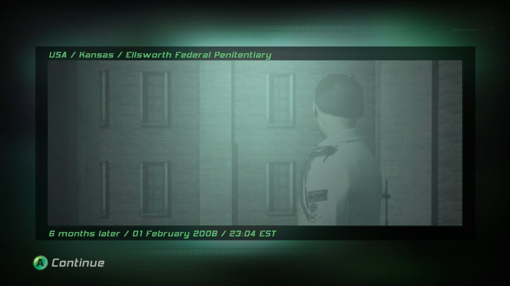

<div align="center">


# SCDA Recomp

**A native Windows port of *Splinter Cell: Double Agent* (Xbox 360), built by static recompilation.**


</div>

> [!WARNING]
> **This is a work in progress.** Every map loads, and you can play and save in it, but there are rendering glitches.
> Some systems are still stubbed. Expect bugs, and don't expect a finished game yet.

---

## What is this?

SCDA Recomp converts the Xbox 360 executable (`SC4_Offline.xex`, Ubisoft Shanghai's single-player build) into native
x86-64 C++. The PowerPC code is **statically recompiled**: no emulator interprets it at run time. A small host runtime
stands in for the console:

- **Kernel and XAM:** 150+ `xboxkrnl` / `xam` calls run on Win32 (threads, files, saves, profiles, title relaunch).
- **Xenos GPU:** the PM4 command processor feeds a Direct3D 11 renderer. Shader microcode is translated to HLSL at run time.
- **Audio:** XMA is decoded through FFmpeg's WMA Pro decoder and output through XAudio2.

## Screenshots

All shots come from the current build at 1280x720, running natively on Windows.

| | |
|:-:|:-:|
|  |  |
| **Iceland**: Osprey bay before the drop | **Ellsworth Penitentiary**: helping Jamie escape |
|  |  |
| **Sea of Okhotsk**: HALO jump toward the supertanker | **Sea of Okhotsk**: diving under the ice |
|  |  |
| **Cozumel**: cruise ship at dawn | **Kinshasa**: the city under fire |
|  |  |
| **Kinshasa**: courtyard in daylight | **Kinshasa**: JBA hideout |
|  |  |
| **New York**: disarming the bomb on the boat | Mission briefing screen |

## Status

| Area | State |
|-|-|
| Boot, menus, profile | ✅ Main menu and profile sign-in |
| Missions | ✅ All 18 single-player maps load and play, at the game's 30 fps cap |
| Menu to mission transitions | ✅ In-process title relaunch with launch data (no restart) |
| Save / load | ✅ Saves to `%LOCALAPPDATA%\SCDARecomp`; position and difficulty restore |
| Graphics | 🟡 Most scenes match the console. Some glitches remain (see below) |
| Audio | ✅ Music, 3D sound effects, dialogue (XMA) and Bink video audio |
| Input | ✅ Xbox controller. 🟡 Mouse look and keyboard are new and barely tested |
| Multiplayer / Xbox Live | ❌ Not planned for now (network calls are stubbed) |

**Known issues**
- In Iceland the Osprey bay ceiling sometimes fails to render, leaving sky visible behind the cables.
- Small differences from the console in fog, light shafts and some edges of the under-ice sky.
- The renderer is a straightforward D3D11 path. There are no upscaling or widescreen extras yet.

## Getting started

> [!IMPORTANT]
> **No game files are included or distributed.** You need your own copy of *Splinter Cell: Double Agent* for Xbox 360.

1. Build the runtime and the installer (`tools/installer/build.bat`). No prebuilt releases exist yet.
2. Run `SCDA_Setup.exe`, pick your disc image (`.iso`) and an install folder. It checks the executable's
   SHA-256, extracts the game files to `<dir>\game` and prepares the flat image.
3. Run `scda.exe` from the install folder.

Settings (resolution scale, window mode, VSync, mouse) live in `settings.ini` next to the executable.


## Building from source

Requirements: Windows 10/11 x64, Visual Studio Build Tools 2022 (CMake + Ninja), LLVM `clang-cl`, Python 3, Git.

```bat
:: 1. third-party sources go in external/ (XenonRecomp, XenosRecomp, UnleashedRecomp, ffmpeg)
tools\build_xenonrecomp.bat        :: applies tools\patches\xenonrecomp_scda.patch
tools\xex_dump\build.bat
tools\ffmpeg\configure.bat
:: 2. recompile the game's PowerPC code into generated/ (needs your own SC4_Offline.xex in assets/)
sh tools/recomp.sh
:: 3. build the runtime + tests
tools\build_runtime.bat
tools\test_runtime.bat
```

`STATE.md` holds the full build notes, debug environment variables and current findings.

## Project layout

| Path | Contents |
|-|-|
| `runtime/` | Host runtime: kernel/XAM, threads, memory, GPU (PM4 + D3D11 + shader translator), audio |
| `config/` | XenonRecomp TOML: functions, jump tables, helpers |
| `tools/` | Installer, XEX dumper, STFS extractor, recompile and check scripts, tests |
| `docs/` | Triage reports, specs, screenshots |

## Credits and legal

Built on [XenonRecomp](https://github.com/hedge-dev/XenonRecomp), [XenosRecomp](https://github.com/hedge-dev/XenosRecomp)
and patterns from [UnleashedRecomp](https://github.com/hedge-dev/UnleashedRecomp) by hedge-dev. Format knowledge comes
from [Xenia](https://github.com/xenia-project/xenia), and audio from [FFmpeg](https://ffmpeg.org). See
[`THIRD_PARTY_NOTICES.md`](THIRD_PARTY_NOTICES.md).

Licensed under **GPL-3.0** ([`LICENSE`](LICENSE)).
*Splinter Cell: Double Agent* is the property of Ubisoft. This project is not affiliated with or endorsed by
Ubisoft or Microsoft, and it contains no game data. Screenshots are shown only to document the project's progress.
