<div align="center">

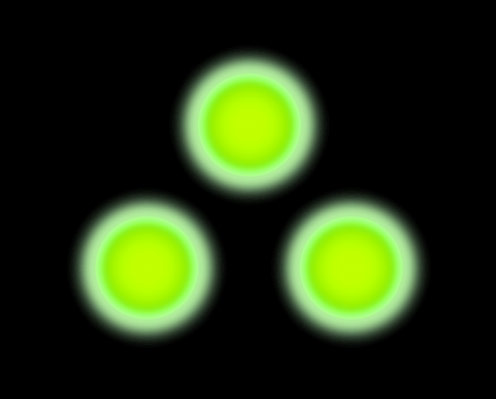

# SCDA V1 Recomp

**A native Windows port of *Splinter Cell: Double Agent* (Xbox 360), built by static recompilation.**


</div>

> [!WARNING]
> **This is a work in progress.** Every map loads, and you can play and save in it, but there are rendering glitches.
> Some systems are still stubbed. Expect bugs, and don't expect a finished game yet.

---

## What is this?

SCDA Recomp converts the Xbox 360 executable (`SC4_Offline.xex`, Ubisoft Shanghai's single-player build) into native
x86-64 C++. The PowerPC code is **statically recompiled**: no emulator interprets it at run time. A small host runtime
stands in for the console:

- **Kernel and XAM:** 150+ `xboxkrnl` / `xam` calls run on Win32 (threads, files, saves, profiles, title relaunch).
- **Xenos GPU:** the PM4 command processor feeds a Direct3D 11 renderer. Shader microcode is translated to HLSL at run time.
- **Audio:** XMA is decoded through FFmpeg's WMA Pro decoder and output through XAudio2.

## Recent progress

- **Missions end for real.** The game's own mission-ending script now runs end to end. 01_Intro shows MISSION
  COMPLETE, saves campaign progress to the profile, plays the Iceland-to-Jail cutscene and relaunches straight into
  Ellsworth Penitentiary, all in one session. Inside a mission, the move to the next part (for example Sea of
  Okhotsk part 1 to part 2) carries Sam's state across (`TRAVELDATA`).
- **Higher internal resolution.** `Scale=2..4` in `settings.ini` renders at 2560x1440 to 5120x2880 and box-filters
  down to the window, which acts as supersampling anti-aliasing. Kinshasa, the heaviest map, holds the game's 30 fps
  cap at `Scale=2`.
- **Texture mipmaps and anisotropic filtering.** Textures use the game's own authored mip levels (including the packed
  mip tail of small textures), so distant surfaces no longer shimmer. `Anisotropy=16` sharpens floors and walls seen at an angle.
- **Auto-exposure fixed at higher scales.** Scenes no longer turn twice as bright above `Scale=1`.
- **In-mission flow verified.** Load last checkpoint after ASSIGNMENT FAILED, Restart Mission, Quit to the main menu
  and loading a save from the pause menu all work, repeatedly, in one session.
- **Mouse look fixed with a controller plugged in.** A pad's resting stick drift used to block mouse and keyboard
  input. Stick values inside the XInput deadzone now count as idle. Mouse direction is checked in game.
- **Shader census clean.** With an empty shader cache, every map translates and compiles its shaders (490 in all) with
  no failures.

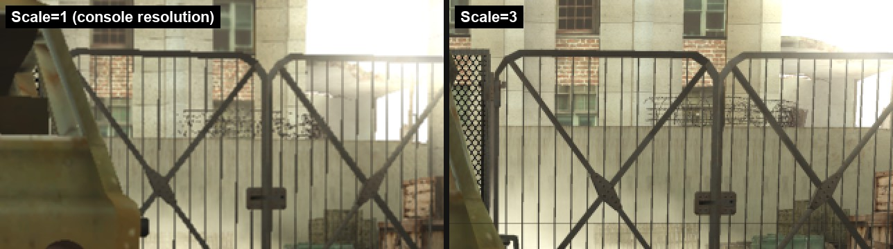

*Kinshasa at the console's 1280x720 (left) and at `Scale=3` (right), zoomed in. The two shots come from separate
runs, so the camera position differs slightly.*

## Screenshots

Shots come from the current build, running natively on Windows. Shots marked *Scale 2* or *Scale 3* use the internal
resolution setting; the rest are at the console's 1280x720.

| | |
|:-:|:-:|
| 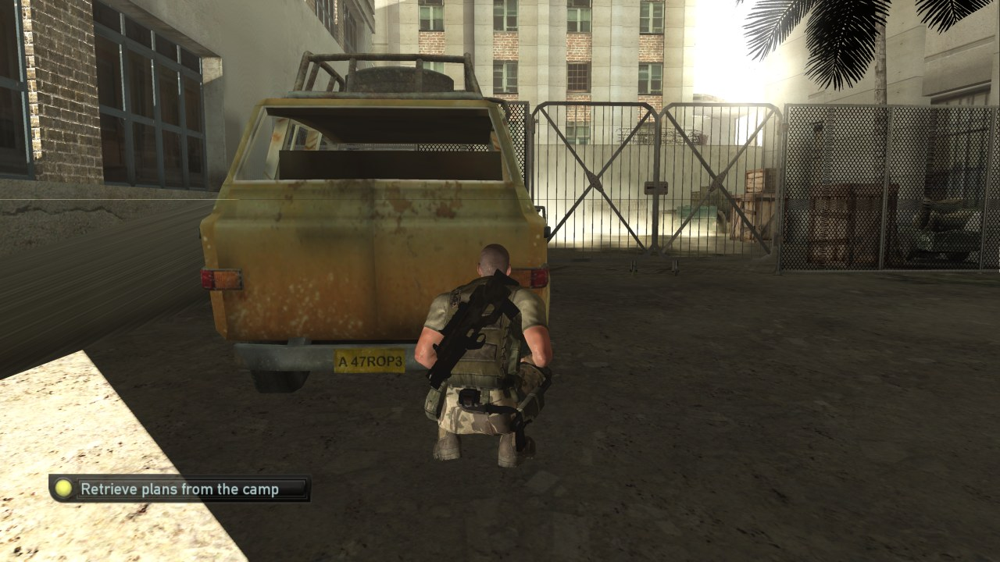 | 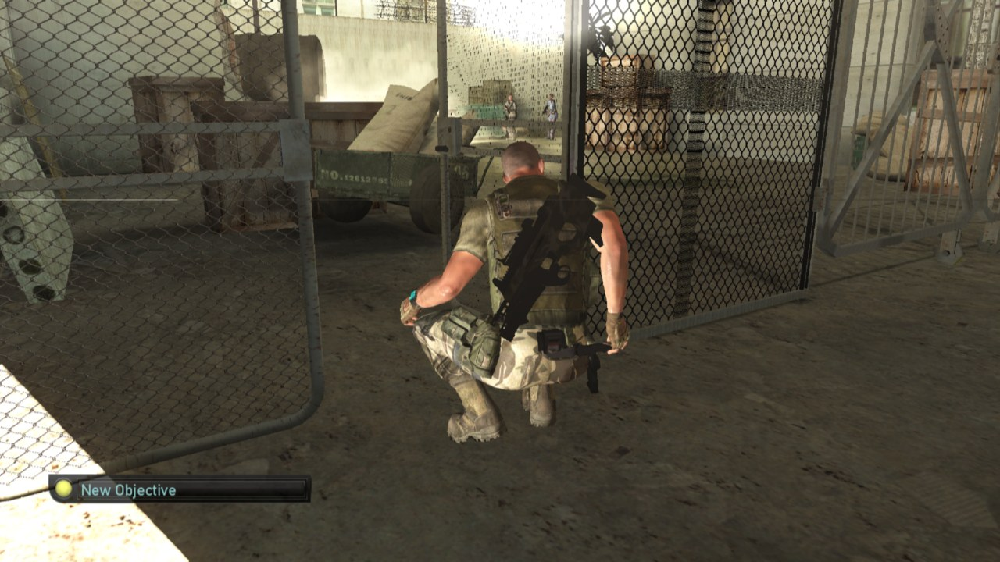 |
| **Kinshasa**: retrieving the plans (*Scale 3*) | **Kinshasa**: through the gate (*Scale 2, 16x anisotropic*) |
| 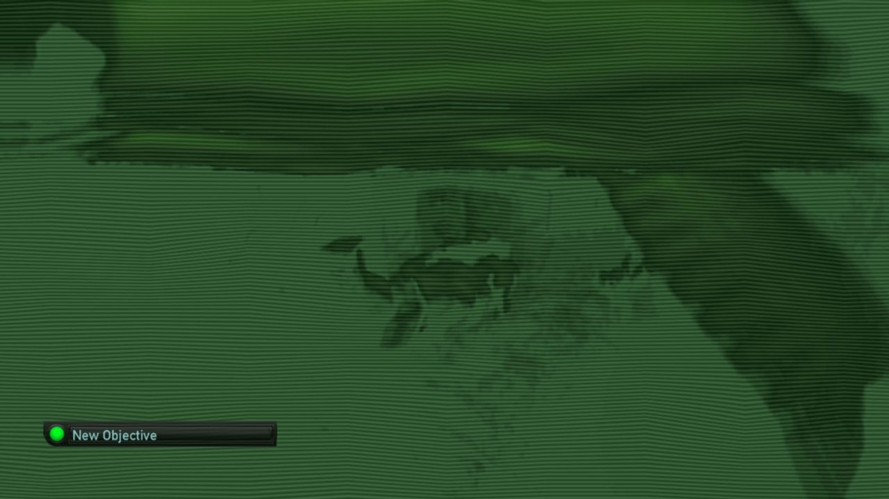 | 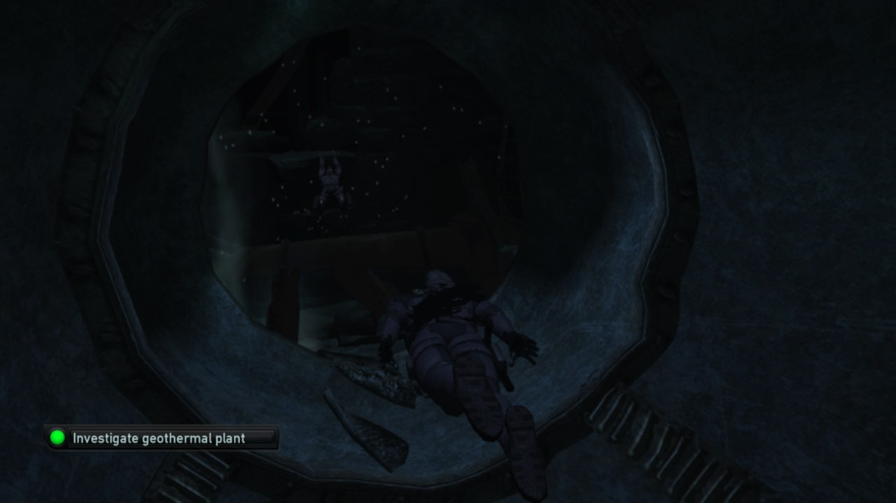 |
| **Iceland**: night vision under the ice | **Iceland**: swimming through the plant's intake pipe |
| 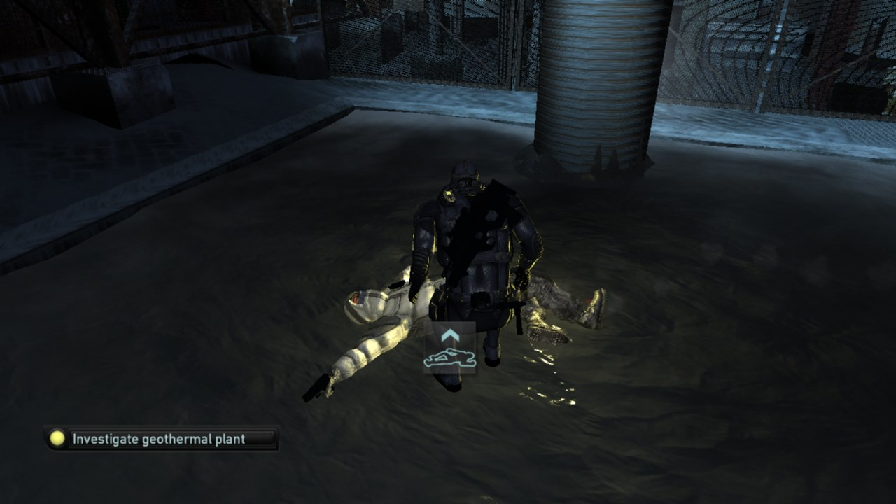 | 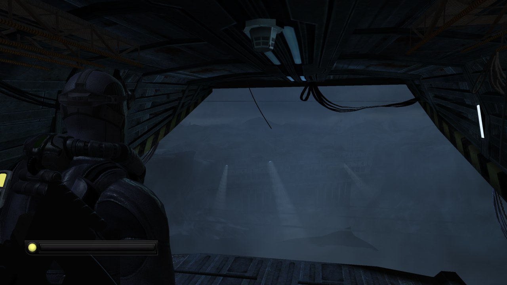 |
| **Iceland**: surfacing at the geothermal plant | **Iceland**: Osprey bay before the drop (*Scale 2*) |
| 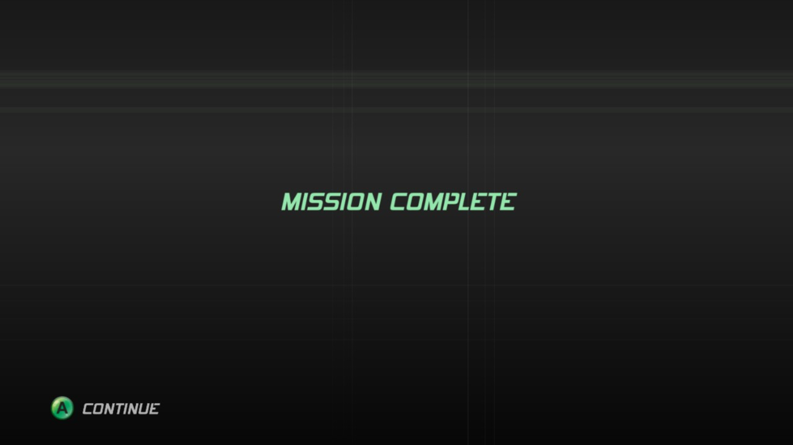 | 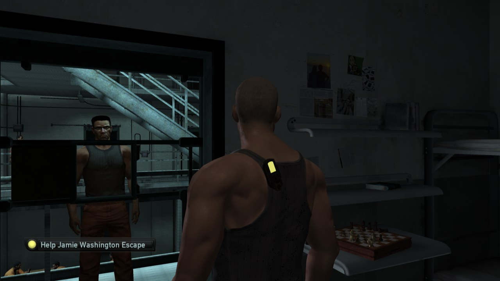 |
| **MISSION COMPLETE** after Iceland, then on to the next mission | **Ellsworth Penitentiary**: helping Jamie escape (*Scale 3*) |
| 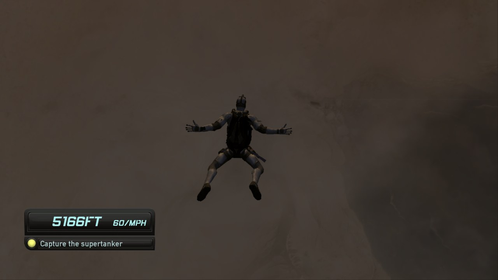 | 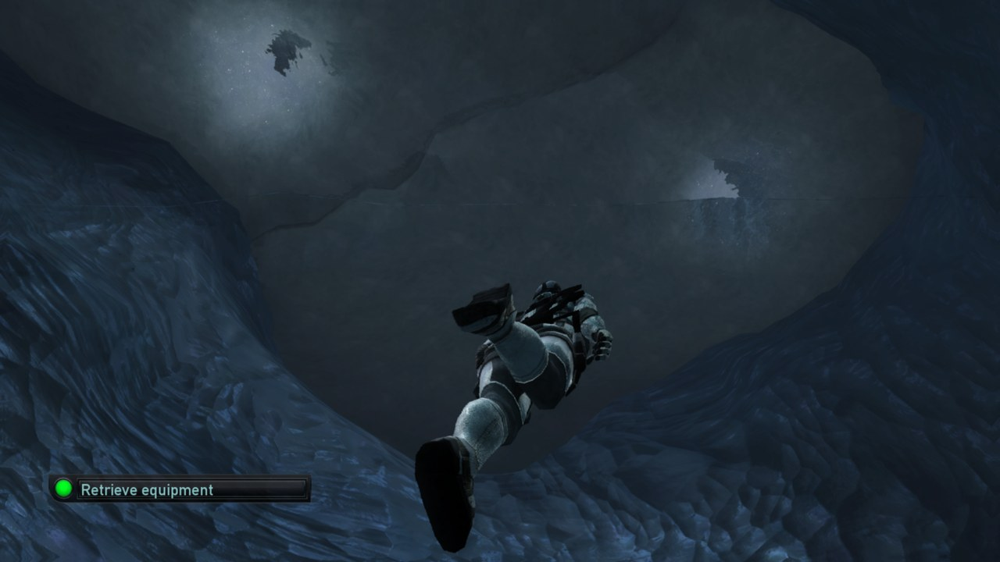 |
| **Sea of Okhotsk**: HALO jump toward the supertanker (*Scale 2*) | **Sea of Okhotsk**: diving under the ice (*Scale 2*) |
| 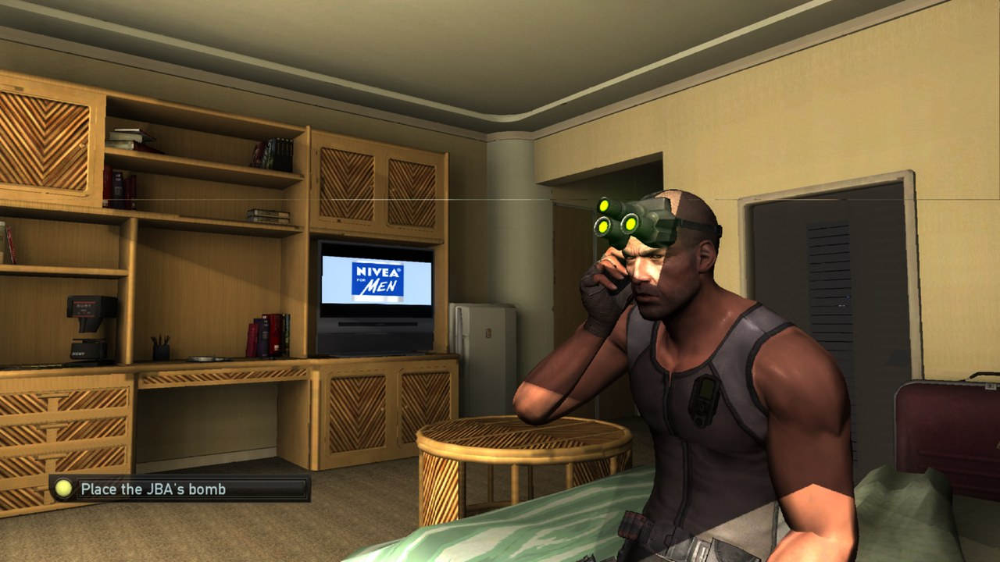 | 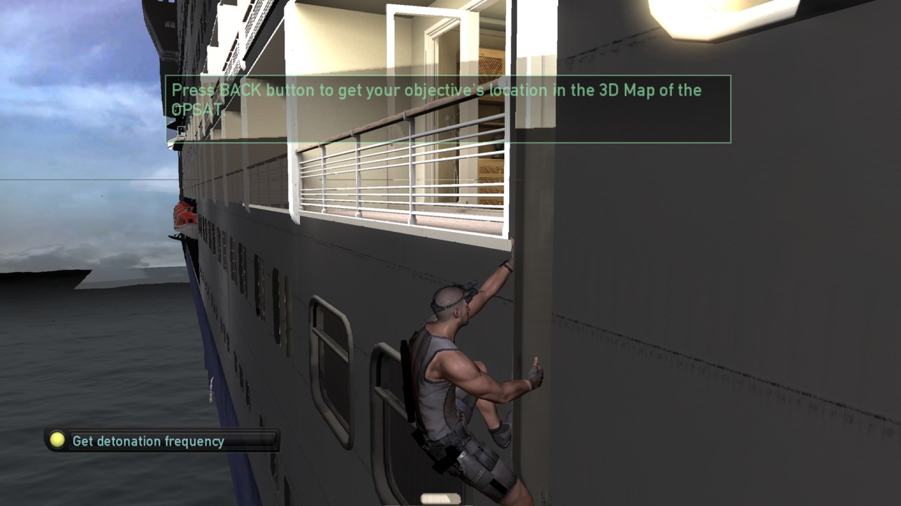 |
| **Cozumel**: Sam's cabin on the cruise ship (*Scale 2*) | **Cozumel**: climbing the hull (*Scale 2*) |
| 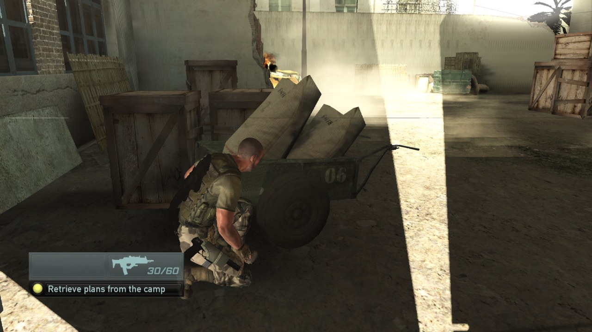 | 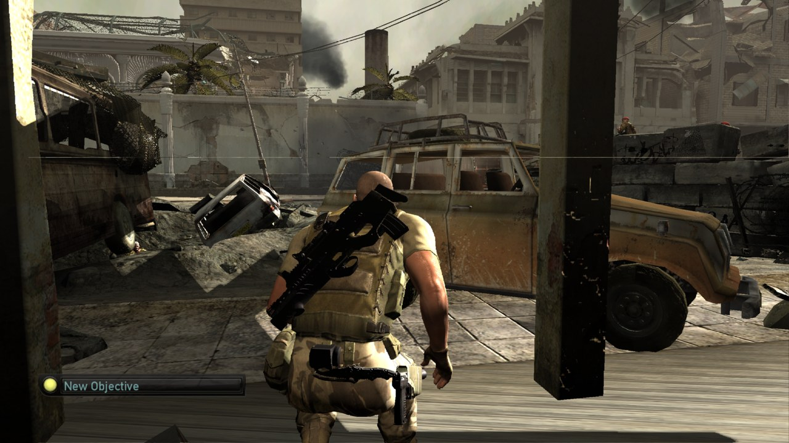 |
| **Kinshasa**: retrieving the plans from the camp (*Scale 2*) | **Kinshasa**: the ruined streets (*Scale 2*) |
| 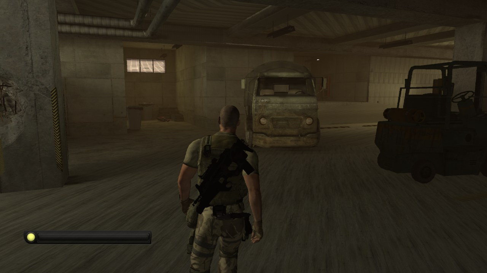 | 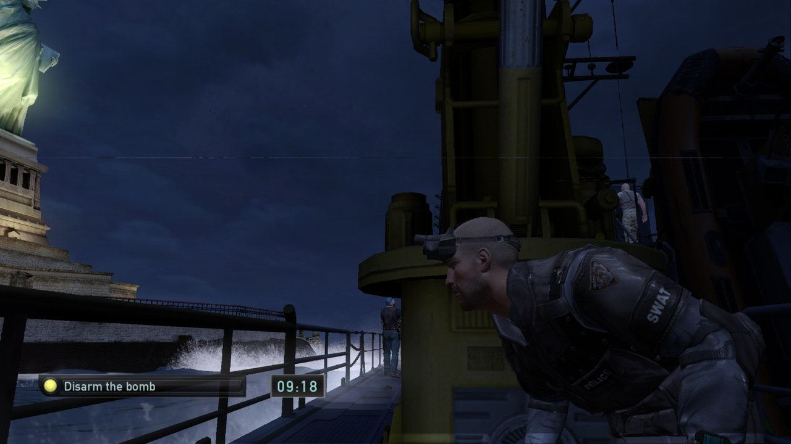 |
| **Kinshasa**: underground garage (*Scale 2*) | **New York**: the bomb boat at Liberty Island (*Scale 2*) |

## Status

| Area | State |
|-|-|
| Boot, menus, profile | ✅ Main menu and profile sign-in |
| Missions | ✅ All 18 single-player maps load and play, at the game's 30 fps cap |
| In-mission flow | ✅ Checkpoint reload after failure, restart mission, quit to menu, load from pause |
| Menu to mission transitions | ✅ In-process title relaunch with launch data (no restart) |
| Mission to mission | ✅ MISSION COMPLETE, progress saved, cutscene, next mission loads (tested with a debug trigger, not a full playthrough) |
| Save / load | ✅ Saves to `%LOCALAPPDATA%\SCDARecomp`; position and difficulty restore |
| Graphics | 🟡 Most scenes match the console. Some glitches remain (see below). Internal resolution up to 4x, mipmaps, anisotropic filtering |
| Audio | ✅ Music, 3D sound effects, dialogue (XMA) and Bink video audio |
| Input | ✅ Xbox controller. 🟡 Mouse look and keyboard are new and barely tested |
| Multiplayer / Xbox Live | ❌ Not planned for now (network calls are stubbed) |

**Known issues**
- Small differences from the console in fog, light shafts and some edges of the under-ice sky.
- The renderer is a straightforward D3D11 path. No ultrawide support yet.
- Above `Scale=1`, some post-processing passes can miss one pixel row/column at the screen edge, and a faint
  horizontal line can appear about a third of the way down the screen (where the GPU splits the frame into tiles).

## What to look forward to

Planned next, roughly in order:

1. **New York at full speed.** `10_newyork_02` runs at about 28 fps, the only map under the 30 fps cap. Profiling comes next.
2. **Closer to the console's look.** The Xenos GPU clamps each blend write, and Direct3D 11 does not. Matching this
   should fix the remaining small differences in fog and light shafts.
3. **Seamless music loops.** A short seam (512 samples) remains where some music tracks loop.
4. **Full campaign playthrough.** Play every mission through by hand, start to finish.
5. **Prebuilt releases.** An installer release for people who don't want to build from source.
6. **Ultrawide and more PC options**, once the renderer is stable.

## Getting started

> [!IMPORTANT]
> **No game files are included or distributed.** You need your own copy of *Splinter Cell: Double Agent* for Xbox 360.

1. Build the runtime and the installer (`tools/installer/build.bat`). No prebuilt releases exist yet.
2. Run `SCDA_Setup.exe`, pick your disc image (`.iso`) and an install folder. It checks the executable's
   SHA-256, extracts the game files to `<dir>\game` and prepares the flat image.
3. Run `scda.exe` from the install folder.

Settings live in `%LOCALAPPDATA%\SCDARecomp\settings.ini`:

```ini
[Display]
Scale=2
Anisotropy=16
Mode=borderless
VSync=1
[Input]
MouseLook=1
MouseSensitivity=1.0
MouseInvertY=0
```

`Scale` (1-4) renders at 1280x720 times Scale and downsamples to the window (2 = 2560x1440).
`Anisotropy` (1-16, default 1) sets the minimum anisotropic filtering. `Mode` is `windowed`, `borderless` or `fullscreen`. The parser has no inline comments.

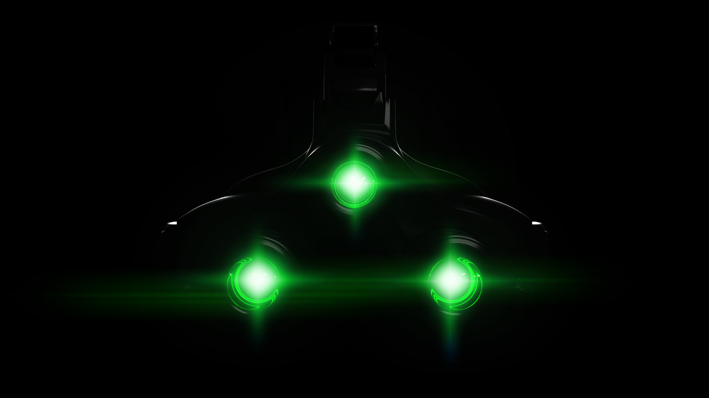

## Building from source

Requirements: Windows 10/11 x64, Visual Studio Build Tools 2022 (CMake + Ninja), LLVM `clang-cl`, Python 3, Git.

```bat
:: 1. third-party sources go in external/ (XenonRecomp, XenosRecomp, UnleashedRecomp, ffmpeg)
tools\build_xenonrecomp.bat        :: applies tools\patches\xenonrecomp_scda.patch
tools\xex_dump\build.bat
tools\ffmpeg\configure.bat
:: 2. recompile the game's PowerPC code into generated/ (needs your own SC4_Offline.xex in assets/)
sh tools/recomp.sh
:: 3. build the runtime + tests
tools\build_runtime.bat
tools\test_runtime.bat
```

`STATE.md` holds the full build notes, debug environment variables and current findings.

## Project layout

| Path | Contents |
|-|-|
| `runtime/` | Host runtime: kernel/XAM, threads, memory, GPU (PM4 + D3D11 + shader translator), audio |
| `config/` | XenonRecomp TOML: functions, jump tables, helpers |
| `tools/` | Installer, XEX dumper, STFS extractor, recompile and check scripts, tests |
| `docs/` | Triage reports, specs, screenshots |

## Credits

Built on [XenonRecomp](https://github.com/hedge-dev/XenonRecomp), [XenosRecomp](https://github.com/hedge-dev/XenosRecomp)
and patterns from [UnleashedRecomp](https://github.com/hedge-dev/UnleashedRecomp) by hedge-dev. Format knowledge comes
from [Xenia](https://github.com/xenia-project/xenia), and audio from [FFmpeg](https://ffmpeg.org). See
[`THIRD_PARTY_NOTICES.md`](THIRD_PARTY_NOTICES.md). The source code is licensed under **GPL-3.0** ([`LICENSE`](LICENSE)).

## Legal

Unofficial fan project, not affiliated with or endorsed by Ubisoft or Microsoft. *Splinter Cell*, *Splinter Cell:
Double Agent*, Sam Fisher and all related characters, names, logos and content are the property of Ubisoft
Entertainment. Xbox and Xbox 360 are trademarks of Microsoft.

- **No game data is included.** This repository contains only original source code, build scripts and configuration
  (function addresses and jump tables). It ships no executables, assets, audio, video or text from the game.
- **You must own the game.** The installer works only from your own *Splinter Cell: Double Agent* Xbox 360 disc image.
  It checks the image's hash and builds the game files on your PC. Do not ask for or share game files or disc images
  here; such issues will be closed.
- **No piracy.** This project does not help anyone obtain the game. To read the game's code, the tools decrypt and
  unpack the executable from your own disc on your PC, as other Xbox 360 recompilation projects do.
- **Screenshots** in `docs/images/` were captured from this project running the author's own copy of the game. They
  are shown only to document the port's progress.
- **Takedown requests:** if you are a rights holder and have a concern, please open an issue or contact the
  maintainer. It will be addressed promptly.
